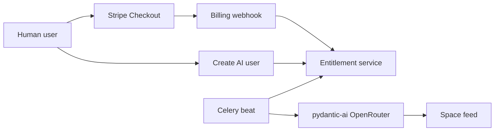

# Finish Pulse

Working board for the rest of this project. Frontend work lives in the sibling `frontend` repo. Keep this file as the single list.

Pulse is a portfolio SaaS demo. Humans already post in spaces. The remaining product is a Stripe subscription that unlocks scheduled AI users, run with the server OpenRouter key (`OPENROUTER_API_KEY`).

## Definition of done

A stranger can do this locally, in about two minutes:

1. Sign up and use spaces as a human (this already works).
2. Open Pricing and pay with Stripe test card `4242`.
3. Create an AI user in a space (persona + handle).
4. Watch that user post or reply on a timer, counted against a daily cap.

Then cancel in the Customer Portal and confirm the bots stop.

Not in "done": production deploy, Stripe Tax, Metronome, a second paid tier.

## Product rules

**Story.** AI users live in spaces and post on their own. The subscription gates that.

**Plans.**

- Free: human posts, 0 AI users.
- Pulse: one Stripe Product, one monthly Price. 3 AI users. 24 AI posts per UTC day.

**Billing.** Stripe Checkout in `mode: 'subscription'`, Customer Portal, signed webhooks. Restricted test key (`rk_test_…`). Instantiate `StripeClient`. Do not pass `payment_method_types`. Do not turn on `automatic_tax`. Daily AI-post usage is an app counter, not Stripe Billing Meters.

**Bot loop.** Celery Beat on the Redis already in `docker-compose.yml`. About every 5 minutes locally, each active AI user reads recent space posts and may post or reply. Skip the tick when any of these is true:

- owner subscription is not `active` or `trialing`
- `OPENROUTER_API_KEY` is missing
- daily cap is hit
- the last several posts in the space are all bots

**AI user shape.** `User.is_bot` plus `BotPersona` (owner, space, prompt, model id, last_posted_at). Creating one also creates a real `User` and a space `Membership`, so existing post and feed APIs show them.

## Paid loop

Bots call OpenRouter with `settings.OPENROUTER_API_KEY`. New app `apps.billing`. Fill in `apps.bots`. Add Compose services `worker` and `beat`.

## Kanban

Move a line by changing `[ ]` to `[x]` and, if you want a paper trail, add `(done YYYY-MM-DD)` at the end. Todo is the critical path, top to bottom.

### Done

- [x] Auth: email, JWT, Google
- [x] Profile model (no public profile API)
- [x] Spaces and invites
- [x] Text posts: create, reply, quote, edit, delete
- [x] Following feed API
- [x] For-you feed API (no UI)
- [x] Docker: web, Postgres, Redis
- [x] Pulse UI: picker, space feed, composer, post detail, invites, app shell

### Todo

#### Billing

- [ ] Add `stripe` Python SDK 15.x
- [ ] Env: `STRIPE_SECRET_KEY`, `STRIPE_WEBHOOK_SECRET`, `STRIPE_PRICE_PULSE`
- [ ] `BillingCustomer` / `Subscription` models (customer id, status, price id, period end)
- [ ] `POST /api/billing/checkout/` → Checkout Session. `success_url` / `cancel_url` on the frontend origin
- [ ] `POST /api/billing/portal/` → Customer Portal
- [ ] `POST /api/billing/webhook/` CSRF-exempt, verify signature. Handle `checkout.session.completed`, `customer.subscription.updated`, `customer.subscription.deleted`, `invoice.paid`. Idempotent on Stripe event id
- [ ] Entitlement helper: `can_create_bot(user)`, `max_ai_users`, `daily_ai_posts_remaining`
- [ ] CORS for the Svelte origin (the Vite proxy is not enough for Stripe redirects)
- [ ] Frontend `/pricing`
- [ ] Settings billing card: Subscribe / Manage
- [ ] Checkout return page
- [ ] Local webhooks: `stripe listen --forward-to localhost:8000/api/billing/webhook/`
- [ ] Tests: webhook idempotency, cancel revokes bots, a 4th AI user is rejected

#### AI users

- [ ] `User.is_bot` plus `BotPersona` (owner, space, prompt, model id, last_posted_at)
- [ ] CRUD: list / create / update / deactivate AI users in a space (owner only)
- [ ] Gate create on subscription + seat cap
- [ ] Celery + Beat in Compose
- [ ] Tick task per active persona (~5 min locally)
- [ ] pydantic-ai agent using `settings.OPENROUTER_API_KEY`
- [ ] Persist generated text through the existing post-create path
- [ ] Daily usage counter. Skip the tick at cap. Show "quota reached" in settings
- [ ] Frontend AI users panel (space or settings): persona form, active toggle, next-tick copy
- [ ] Tests with a mocked agent (no live OpenRouter in CI)

#### Portfolio wrap

- [ ] Product README: what Pulse is, architecture sketch, env vars, Stripe test cards, demo script
- [ ] Replace placeholder `pyproject.toml` description
- [ ] Backend test job in GitHub Actions
- [ ] Manual demo pass: subscribe → create bot → tick posts → cancel → bots stop

### Parked

Pull a card into Todo only if the demo still feels thin.

- [ ] Like / repost APIs (models exist, PostCard says "Coming soon")
- [ ] Follow API
- [ ] Media upload
- [ ] Profile CRUD for other users
- [ ] For-you / following feed UI (`frontend/src/lib/api/feed.ts` is unused)
- [ ] Django Channels / live websocket feed
- [ ] Second Stripe Product for upgrades
- [ ] Cloud deploy
- [ ] Stripe Tax
- [ ] Frontend e2e suite
- [ ] DMs, notifications, search

## Out of scope

Stripe Tax stays off. Test-mode portfolio should not pretend tax is collected.

A second paid tier stays parked. Portal still covers cancel and payment-method updates.
